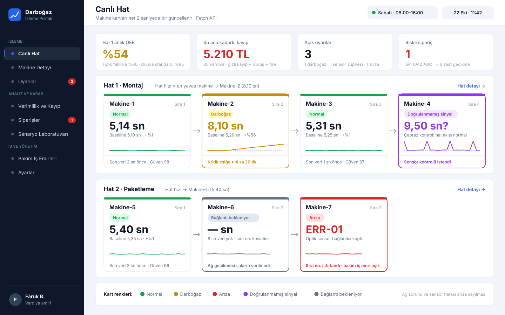
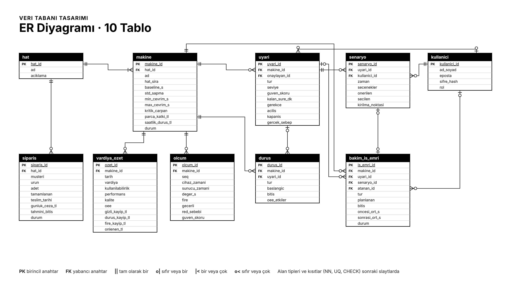

# Darboğaz Portalı

**Otonom Darboğaz İzleme ve Erken Uyarı Portalı**

Üretim hattındaki makinelerin *durmadan yavaşlamasını* erkenden yakalayan, gelen sinyalin gerçek olup olmadığını doğrulayan ve vardiya amirine ne zaman bakım yapması gerektiğini söyleyen web tabanlı bir karar destek portalı.

> BİL 2119 İnternet Programcılığı 2 · 2026-2027 Güz Dönemi
> Manisa Celal Bayar Üniversitesi · Manisa Teknik Bilimler MYO
> Danışman: Öğr. Gör. Dr. Semih GENÇAY



---

## Proje ekibi

| Öğrenci No | Ad Soyad | GitHub |
|---|---|---|
| 2516013031 | Melih EFE | [@melihefoe](https://github.com/melihefoe) |
| 2516013007 | Ali Faruk BAL | [@faruk-bal](https://github.com/faruk-bal) |

---

## Problem

Seri üretim hatları birbirine bağlı makinelerden oluşur ve hattın hızı **en yavaş makinenin hızına** iner. Bir makine durmadan yavaşladığında (örneğin parça başına 5,2 sn yerine 8 sn) hiçbir rapor bunu göstermez. Bu **gizli kayıp** günlerce sessizce büyür ve sipariş teslim tarihleri kaçırılır.

İkinci sorun **güvenilmeyen hata mesajıdır.** Arızalı bir sensör ya da ağ gecikmesi, makine bozulmuş gibi görünebilir. Sistem buna inanırsa hat gereksiz yere durdurulur.

## Çözüm

Makinelerden 2 saniyede bir gelen çevrim süresi ölçümleri önce bir **sinyal doğrulama katmanından** geçer. Ardından sistem her makinenin kendi normalini (**baseline**) öğrenir ve yavaşlamayı arıza oluşmadan tespit eder.

**Sinyal doğrulama (5 kontrol → güven skoru 0–100)**
1. Sıra numarası ve tamponlama kontrolü
2. Fiziksel olabilirlik (1–300 sn aralığı)
3. Son 5 ölçümün medyanı (tek sıçramalar karara girmez)
4. Donmuş sensör kontrolü
5. Komşu makineyle çapraz kontrol

**Uyarı kuralları**
- 3 ardışık medyan > baseline × 1,15 → **sarı** uyarı
- Kritik eşik: baseline × 1,80 → kritik eşiğe kalan süre hesaplanır
- Baseline öğrenilmeden uyarı üretilmez

**Durum renkleri**

| Renk | Anlamı |
|---|---|
| 🟢 Yeşil | Normal çalışma |
| 🟡 Sarı | Sinsi yavaşlama (darboğaz) |
| 🔴 Kırmızı | Gerçek arıza |
| 🟣 Mor | Doğrulanmamış / şüpheli sensör sinyali |
| ⚪ Gri | Bağlantı bekleniyor (ağ gecikmesi, alarm üretmez) |

### Doğrulanmış verinin üstündeki modüller

| Modül | Yanıtladığı soru |
|---|---|
| **OEE** (Kullanılabilirlik × Performans × Kalite) | Hat ne kadar verimli çalışıyor? |
| **Kayıp maliyeti** (TL) | Bu yavaşlama bize kaç TL'ye mal oluyor? |
| **Sipariş teslim tahmini** | Hangi sipariş gecikecek, ceza riski ne? |
| **Senaryo laboratuvarı** | Bakımı ne zaman yapmalıyız? (kırılma noktası) |

---

## Kullanıcı rolleri

- **Operatör:** hattı canlı izler, kendisine atanan bakım iş emirlerini tamamlar.
- **Vardiya amiri:** uyarıları yönetir; verimlilik, kayıp ve sipariş durumunu izler; bakım kararını verir.

## Teknolojiler

| Katman | Teknoloji |
|---|---|
| Arayüz | HTML, CSS, JavaScript |
| Canlı veri | Fetch API (2 sn'de bir güncelleme) |
| Sanal IoT cihazı | JavaScript `setInterval` |
| Sunucu ve iş kuralları | PHP |
| Veritabanı | MySQL (InnoDB) |

---

## Sayfalar

| # | Sayfa | Wireframe | Mockup (SVG) |
|---|---|---|---|
| 01 | Giriş | [png](docs/wireframe/01_Giris.png) | [svg](docs/mockup/svg/01_Giris.svg) |
| 02 | Canlı Hat | [png](docs/wireframe/02_Canli_Hat.png) | [svg](docs/mockup/svg/02_Canli_Hat.svg) |
| 03 | Makine Detayı | [png](docs/wireframe/03_Makine_Detayi.png) | [svg](docs/mockup/svg/03_Makine_Detayi.svg) |
| 04 | Uyarılar | [png](docs/wireframe/04_Uyarilar.png) | [svg](docs/mockup/svg/04_Uyarilar.svg) |
| 05 | Verimlilik ve Kayıp | [png](docs/wireframe/05_Verimlilik_ve_Kayip.png) | [svg](docs/mockup/svg/05_Verimlilik_ve_Kayip.svg) |
| 06 | Siparişler | [png](docs/wireframe/06_Siparisler.png) | [svg](docs/mockup/svg/06_Siparisler.svg) |
| 07 | Senaryo Laboratuvarı | [png](docs/wireframe/07_Senaryo_Laboratuvari.png) | [svg](docs/mockup/svg/07_Senaryo_Laboratuvari.svg) |
| 08 | Bakım İş Emirleri | [png](docs/wireframe/08_Bakim_Is_Emirleri.png) | [svg](docs/mockup/svg/08_Bakim_Is_Emirleri.svg) |
| 09 | Ayarlar | [png](docs/wireframe/09_Ayarlar.png) | [svg](docs/mockup/svg/09_Ayarlar.svg) |
| 10 | Demo Paneli (gizli) | [png](docs/wireframe/10_Demo_Paneli.png) | [svg](docs/mockup/svg/10_Demo_Paneli.svg) |

Figma: https://www.figma.com/design/S37LA050jX6rrdgVC7TpYV/Untitled?node-id=0-1

## Veritabanı

10 tablo: `hat`, `makine`, `olcum`, `uyari`, `durus`, `bakim_is_emri`, `vardiya_ozet`, `siparis`, `senaryo`, `kullanici`.



## Akış şeması

- [Şekil 1a: Veri hattı (ölçüm → doğrulama → durum)](docs/akis-semasi/sekil-1a-veri-hatti.png)
- [Şekil 1b: Kullanıcı, karar ve bakım akışı](docs/akis-semasi/sekil-1b-kullanici-akisi.png)

---

## Klasör yapısı

```
darbogaz-portali/
├── README.md
├── docs/
│   ├── akis-semasi/      Akış şemaları (Şekil 1a, 1b)
│   ├── er-diyagrami/     ER diyagramı (.drawio kaynak + .png)
│   ├── wireframe/        10 sayfanın wireframe görselleri
│   ├── mockup/
│   │   ├── svg/          Figma'da düzenlenebilir mockup dosyaları
│   │   └── png/          Mockup önizlemeleri
│   ├── sunum/            Ara sunum
│   └── rapor/            Proje öneri formu ve proje anlatımı
└── src/                  Uygulama kodu (geliştirme aşamasında)
    ├── public/           HTML, CSS, JS (arayüz)
    ├── api/              PHP uç noktaları
    └── sql/              Veritabanı şeması
```

## Kapsam dışı

- Gerçek sensör donanımına bağlantı (veriler sanal IoT cihazlarıyla üretilir)
- Makine öğrenmesi modeli eğitimi (yalnızca etiketli veri seti biriktirilir)

Sistem 2 hat ve 7 makine üzerinde gösterilecektir.
